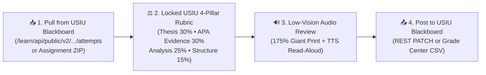

# 🎓 USIU-Africa Accessible Lecturer Assessment & Blackboard Suite

> **Localized for United States International University - Africa (USIU-Africa)**  
> **Target LMS:** `https://blackboard.usiu.ac.ke` (`Blackboard Learn v4001.4.0 • rel.58+b22e012`)  
> **Designed for Low-Vision Accessibility & Zero-Drift Criterion-Referenced Grading**

This repository provides an all-in-one assessment, grading, and Blackboard synchronization suite tailored for **USIU-Africa** faculty (Chandaria School of Business, School of Science & Technology, and School of Humanities & Social Sciences).

It solves two critical problems:
1. **Low-Vision Accessibility:** Replaces tiny, low-contrast interfaces and repetitive copy-pasting with a **Giant-Print High-Contrast Hub** (`100%`, `135%`, `175%` font scaling, Cream/Dark Obsidian toggle) and **1-Click Audio Read-Aloud (`🔊 READ GRADE ALOUD`)** so the lecturer can listen to student submissions, rubric breakdowns, and final grades without eye strain.
2. **Eliminates Inconsistent "Vibes" ChatGPT Prompting:** Enforces a **Locked 4-Pillar USIU Academic Rubric** (`data/usiu_locked_rubrics.json`) mapped to the official **USIU-Africa Grading Scale** (`A` to `F` with GPA quality points in `data/usiu_grading_scale_and_policies.json`), extracting verbatim quotes from each student's submission as audit evidence.

---

## 🔄 Single-Point Workflow (USIU Blackboard → Rubric → Grade Center)



---

## 🌐 Verified Live USIU Blackboard Endpoints (`data/blackboard_endpoints_manifest.json`)

Probed live against `https://blackboard.usiu.ac.ke/learn/api/public/v1/system/version` (`HTTP 200 OK`, Blackboard Learn `4001.4.0`):

| Operation | HTTP Endpoint on `https://blackboard.usiu.ac.ke` |
| :--- | :--- |
| **System Version** | `GET /learn/api/public/v1/system/version` |
| **Instructor Courses** | `GET /learn/api/public/v1/users/me/courses?expand=course` |
| **Gradebook Columns** | `GET /learn/api/public/v2/courses/{courseId}/gradebook/columns` |
| **Student Attempts** | `GET /learn/api/public/v2/courses/{courseId}/gradebook/columns/{columnId}/attempts` |
| **Post Grade & Feedback** | `PATCH /learn/api/public/v2/courses/{courseId}/gradebook/columns/{columnId}/users/{userId}` |

---

## 📂 Repository & Localized USIU Data Structure

```text
USIU_Lecturere/
├── README.md                                           # USIU-Africa Documentation & Endpoint Reference
├── index.html                                          # Low-Vision High-Contrast Interactive Grading Hub (with TTS Read-Aloud)
├── Run_USIU_Lecturer_Grader.bat                        # 1-Click Windows Batch Executor
├── src/
│   ├── usiu_blackboard_grader.py                       # Deterministic Rubric Grader, SAPI Voice Reader & CSV/JSON Exporter
│   └── usiu_bb_browser_bridge.js                       # Live Logged-In Browser Session Bridge for blackboard.usiu.ac.ke
└── data/
    ├── usiu_grading_scale_and_policies.json            # Official USIU-Africa Grading Scale (A to F, GPA 4.0-0.0) & Schools
    ├── usiu_locked_rubrics.json                        # Locked Rubrics (Research Paper & Chandaria Business Case Study)
    ├── blackboard_endpoints_manifest.json              # Verified USIU Blackboard v4001.4.0 REST API Endpoints
    ├── sample_submissions/                             # Localized USIU Student Submissions (APT3040 / BUS4010)
    │   ├── 665421_Amina_Wanjiku.txt                    # Graded: 94.3/100 (A  | GPA 4.0)
    │   ├── 668312_Faith_Chepkoech.txt                  # Graded: 94.1/100 (A  | GPA 4.0)
    │   ├── 666104_Kelvin_Mwangi.txt                    # Graded: 87.7/100 (A- | GPA 3.7)
    │   └── 667890_Brian_Otieno.txt                     # Graded: 64.3/100 (D+ | GPA 1.3)
    └── outputs/
        ├── USIU_Blackboard_GradeCenter_Upload.csv      # Ready for Blackboard Grade Center "Work Offline -> Upload"
        └── USIU_Grading_Audit_Report.json              # Complete Criterion-by-Criterion Audit Trail with Student Quotes
```

---

## 🚀 Quick Start

1. **Interactive Low-Vision Web Hub:** Double-click **[`index.html`](index.html)** and click **`🔊 READ GRADE ALOUD`** or **`🔍 175% Giant`**.
2. **Batch CLI Grader (with optional Windows Voice Read-Aloud):**
   ```bash
   python src/usiu_blackboard_grader.py \
     --submissions-dir data/sample_submissions \
     --out-csv data/outputs/USIU_Blackboard_GradeCenter_Upload.csv \
     --out-json data/outputs/USIU_Grading_Audit_Report.json \
     --speak
   ```
