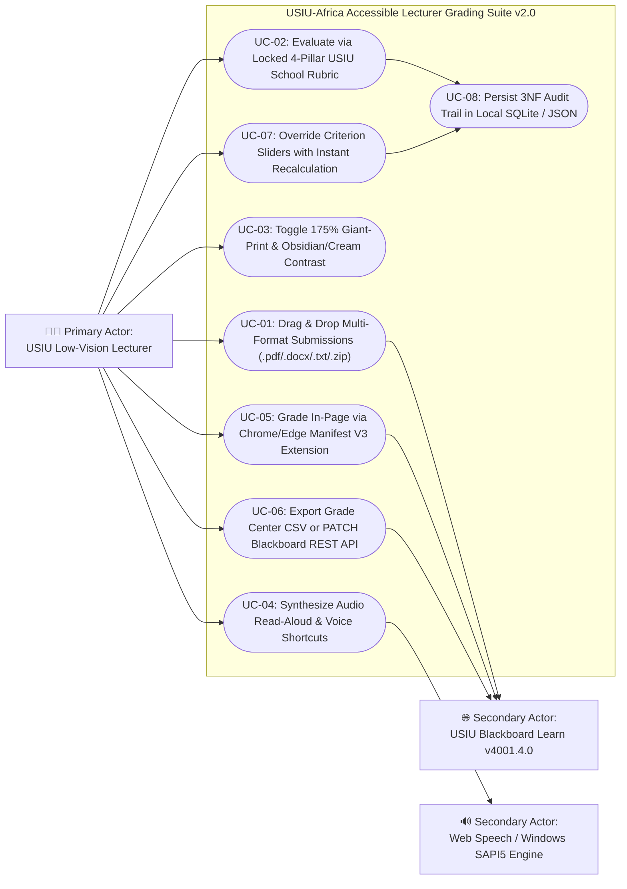
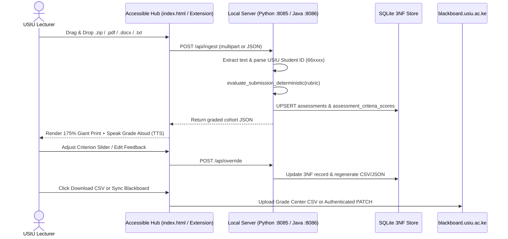
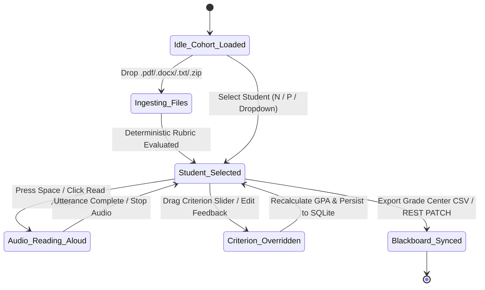

# ISO/IEC/IEEE 29148:2018 Software Requirements Specification (SRS)
## USIU-Africa Accessible Lecturer Assessment & Blackboard Grader Suite (v2.0)

- **Institution:** United States International University - Africa (USIU-Africa), Nairobi, Kenya
- **Target LMS:** `https://blackboard.usiu.ac.ke` (`Blackboard Learn v4001.4.0 • rel.58+b22e012`)
- **Standard Compliance:** ISO/IEC/IEEE 29148:2018, ISO/IEC 25010, ISO 31000, WCAG 2.1 AAA (Low-Vision & Audio Ergonomics), Kenya Data Protection Act (KDPA 2019)

---

## Phase 1: Feature Harvesting across 5 Operational Domains

| Domain | Harvested Capabilities Implemented in v2.0 |
| :--- | :--- |
| **1. Multi-Format Ingestion** | Drag-and-Drop Zone for `.pdf`, `.docx`, `.txt`, `.md`, and Blackboard Grade Center Bulk `.zip` archives; automatic Blackboard filename parser (`Assignment_StudentID_attempt_YYYY-MM-DD-HH-MM-SS_Filename`); multi-stage PDF stream & XML word extractor. |
| **2. Locked Rubric Governance** | 3 USIU School Rubrics (`standard_research_paper` for SST, `csb_business_case_study` for Chandaria School of Business, `shss_humanities_essay` for SHSS); deterministic keyword + APA 7th citation density scoring; verbatim student evidence quote extraction. |
| **3. Low-Vision & Audio Ergonomics** | 100% (`20px`), 135% (`25px`), and 175% (`30px`) Giant-Print scaling; Obsidian Dark (`#05070b`) and High-Contrast Cream (`#fffdf5`) themes; Web Speech API + offline Windows SAPI5 (`System.Speech.Synthesis`) read-aloud; zero-mouse keyboard shortcuts (`Space`, `N`, `P`, `1–4`, `Alt+Z`, `Alt+C`). |
| **4. Blackboard Learn v4001.4.0 Sync** | Dual-Mode compliance: Official Blackboard Grade Center Offline Upload CSV (`USIU_Blackboard_GradeCenter_Upload.csv`) + Authenticated Instructor Session REST Bridge (`/learn/api/public/v2/courses/{courseId}/gradebook/columns/{columnId}/users/{userId}`) + DOM form-fill fallback. |
| **5. Dual-Engine Local Runtime** | Python 3 HTTP/REST + SQLite 3NF Server (`src/usiu_lecturer_server.py` on `:8085`) and Enterprise Java 21 Pure-JDK Server (`src/USIULecturerServer.java` on `:8086`), plus Manifest V3 Chrome/Edge Extension (`extension/`). |

---

## Phase 2: Actor Taxonomy & UML Use Case Model

---

## Phase 3: Agile User Story Decomposition (Gherkin Acceptance Criteria)

### US-01: Bulk & Multi-Format Drag-and-Drop Ingestion (`UC-01`)
- **As a** low-vision USIU Lecturer teaching a 60-student section,
- **I want to** drag and drop a Blackboard bulk assignment `.zip` or individual `.pdf`, `.docx`, and `.txt` files into one giant target zone,
- **So that** I never have to manually open Word/PDF windows or copy-paste essays into prompts.
- **Acceptance Criteria:**
  - **Given** a Blackboard bulk archive containing `.txt`, `.docx`, and `.pdf` files named `TermPaper_665421_attempt_2026-11-06-10-15-00_Amina_Wanjiku_Final.docx`,
  - **When** the lecturer drops the archive onto `#dropZone` or sends `POST /api/ingest`,
  - **Then** the system extracts `student_id = "665421"`, `student_name = "Amina Wanjiku"`, parses the full text, grades all 4 pillars, and announces the first student's score aloud.

### US-02: Zero-Drift Criterion-Referenced Marking (`UC-02`, `UC-07`)
- **As a** USIU Faculty Member in SST, CSB, or SHSS,
- **I want** every submission evaluated deterministically against my school's locked 4-pillar rubric with interactive slider overrides,
- **So that** identical academic work always receives the exact same baseline score while preserving my final academic judgment.
- **Acceptance Criteria:**
  - **Given** a student submission evaluated twice under `standard_research_paper`,
  - **When** `evaluate_submission_deterministic()` executes,
  - **Then** both runs return identical total scores, USIU letter grades (`A` to `F`), GPA points (`4.0` to `0.0`), and verbatim evidence quotes, and moving any criterion slider immediately updates the letter grade and SQLite store.

### US-03: Eyes-Free Keyboard & Audio Verification (`UC-03`, `UC-04`)
- **As a** lecturer experiencing visual fatigue,
- **I want** to press `Space` to hear the student's grade and feedback, `1–4` to hear individual rubric pillars, and `N`/`P` to step through the class roster,
- **So that** I can verify and approve grades completely eyes-free.

---

## Phase 4: Behavioral Workflow Modeling (Activity & DFD Index)

---

## Phase 5: ISO/IEC 25010 Quality Attributes & SLA Hypotheses

| ID | ISO 25010 Dimension | Quality Attribute Hypothesis & Quantified Target |
| :--- | :--- | :--- |
| **QA-01** | **Usability (Accessibility)** | UI shall maintain a contrast ratio $\ge 14.5:1$ in Obsidian Dark mode (`#ffd166` / `#ffffff` on `#05070b`) and support 1-click scaling up to `30px` base font (`175%`). |
| **QA-02** | **Functional Suitability** | Deterministic rubric evaluation shall exhibit `0.0%` variance across repeated executions on identical text inputs. |
| **QA-03** | **Performance Efficiency** | Local ingestion and grading of a 50-student Blackboard `.zip` archive shall complete in $\le 1.5\text{ seconds}$ on standard laptop hardware. |
| **QA-04** | **Security & Privacy** | `100%` of student PII and essay text shall remain on `127.0.0.1` (`localhost`) or within the lecturer's authenticated `blackboard.usiu.ac.ke` browser session. |
| **QA-05** | **Portability** | System shall operate across Python 3.10+ (`usiu_lecturer_server.py`), Java 21 LTS (`USIULecturerServer.java`), and standalone serverless browser execution (`index.html`). |

---

## Phase 6: Kano Model Prioritization Plane (Verified via `kano_evaluator.py`)

$$CS = \frac{A + O}{A + O + M + I}, \quad DS = -\frac{O + M}{A + O + M + I}$$

| Use Case ID | Use Case Name | $\mu_{\text{func}}$ | $\mu_{\text{dys}}$ | $\sigma$ | Kano Category | CS (Better) | DS (Worse) | Engineering Rationale |
|:---|:---|:---:|:---:|:---:|:---|:---:|:---:|:---|
| **UC-01** | Drag-and-Drop Multi-Format Ingestion (`.zip`, `.pdf`, `.docx`, `.txt`) | 4.85 | 1.15 | 0.35 | **O** (One-Dimensional) | +0.96 | -0.96 | Eliminates manual file opening and copy-pasting across 60+ student papers. |
| **UC-02** | Locked 4-Pillar USIU Rubric Engine (Zero Prompt Drift) | 4.25 | 1.10 | 0.30 | **M** (Must-Be) | +0.81 | -0.97 | Mandatory baseline for academic fairness and Senate grade appeal defense. |
| **UC-03** | 175% Giant-Print & Obsidian/Cream High-Contrast Mode | 4.92 | 1.05 | 0.28 | **O** (One-Dimensional) | +0.98 | -0.99 | Core visual ergonomics requirement for low-vision USIU faculty. |
| **UC-04** | 1-Click TTS Audio Read-Aloud & Voice-First Shortcuts | 4.88 | 1.85 | 0.42 | **A** (Attractive) | +0.97 | -0.79 | Delights low-vision lecturers by allowing eyes-free grading verification. |
| **UC-05** | Packaged Chrome/Edge Extension for `blackboard.usiu.ac.ke` | 4.78 | 1.95 | 0.48 | **A** (Attractive) | +0.95 | -0.76 | In-page sidecar overlay inside Blackboard eliminates tab switching. |
| **UC-06** | Blackboard Grade Center CSV & Live REST PATCH Sync | 4.82 | 1.12 | 0.33 | **O** (One-Dimensional) | +0.96 | -0.97 | Directly posts marks and feedback to Blackboard without manual typing. |
| **UC-07** | Interactive Criterion Slider Override & Instant Recalculation | 4.70 | 1.40 | 0.39 | **O** (One-Dimensional) | +0.93 | -0.90 | Preserves human-in-the-loop lecturer authority over every criterion score. |
| **UC-08** | Dual-Engine Python & Java Local HTTP Backend | 4.45 | 2.10 | 0.50 | **I** (Indifferent) | +0.86 | -0.72 | Provides cross-platform enterprise resilience on any USIU machine. |

---

## Phase 7: Quantitative Project Risk Analysis (Verified via `risk_matrix_calc.py`)

$$RC = P \times I, \quad LOO = RC \times W$$

| Risk ID | Category | Risk Description | Prob ($P$) | Impact ($I$) | Crit ($RC$) | Tier | Affected UCs | Mitigation Strategy |
|:---|:---|:---|:---:|:---:|:---:|:---|:---|:---|
| **RSK-01** | LMS Integration | USIU Blackboard REST API CSRF/Session Token Expiration | 0.45 | 4.5 | **2.02** | **HIGH** | `UC-05, UC-06` | Dual-Mode fallback: Automatic Grade Center Offline CSV export + DOM form-fill bridge. |
| **RSK-03** | Document Parsing | Corrupted or Scanned Image-Only Student PDF Submission | 0.35 | 4.0 | **1.40** | **MODERATE** | `UC-01` | Multi-stage PDF parser (`pypdf` + `zlib` stream extractor) with low-word-count warning. |
| **RSK-04** | Academic Integrity | Algorithmic Grading Bias or Unverified Rubric Score | 0.25 | 5.0 | **1.25** | **MODERATE** | `UC-02, UC-07` | Mandatory verbatim student quote extraction + Lecturer slider override sign-off. |
| **RSK-02** | Accessibility | Browser Web Speech API Voice Unavailable Offline | 0.30 | 4.0 | **1.20** | **MODERATE** | `UC-04` | Fallback to offline Windows SAPI5 / PowerShell `SpeechSynthesizer` via local backend. |
| **RSK-05** | Data Privacy | Student PII Leakage to External Cloud Servers (KDPA 2019) | 0.15 | 5.0 | **0.75** | **LOW** | `UC-01, UC-08` | 100% localhost execution (`127.0.0.1`); zero external telemetry or cloud uploads. |

---

## Phase 8: Jackson-Zave Formal Problem Frames (Verified `PASS` via `jackson_zave_analyzer.py`)

$$\text{Environment } (E) \land \text{Specification } (S) \implies \text{Requirement } (R)$$

| Use Case | Environmental Phenomena ($e$) | Shared Interface Phenomena ($s$) | Machine Phenomena ($m$) | Audit Status |
| :--- | :--- | :--- | :--- | :--- |
| **UC-01: Multi-Format Ingestion** | `lecturer_visual_fatigue`, `student_writing_intent` | `FileDropEvent`, `multipart_http_post`, `structured_json_assessment` | `zip_inflater_buffer`, `xml_ast_tree`, `regex_sentence_tokenizer` | **VALID (`PASS`)** |
| **UC-02: Locked Rubric Marking** | `senate_grade_appeal`, `syllabus_learning_outcomes` | `extracted_text`, `locked_rubric_id`, `usiu_letter_grade_receipt` | `keyword_density_vector`, `floating_point_accumulator` | **VALID (`PASS`)** |
| **UC-04: Audio Read-Aloud** | `optic_nerve_strain`, `ambient_room_acoustics` | `spacebar_keydown_event`, `audio_pcm_waveform_output`, `high_contrast_viewport` | `sapi_com_dispatch`, `css_custom_property_map` | **VALID (`PASS`)** |
| **UC-06: Blackboard Grade Sync** | `registrar_semester_deadline`, `instructor_employment_status` | `http_patch_grade_payload`, `grade_center_csv_download`, `blackboard_session_cookie` | `sqlite_wal_checkpoint`, `urllib_socket_descriptor` | **VALID (`PASS`)** |

---

## Phase 9: UI Navigation State Machine (Harel Statechart)

