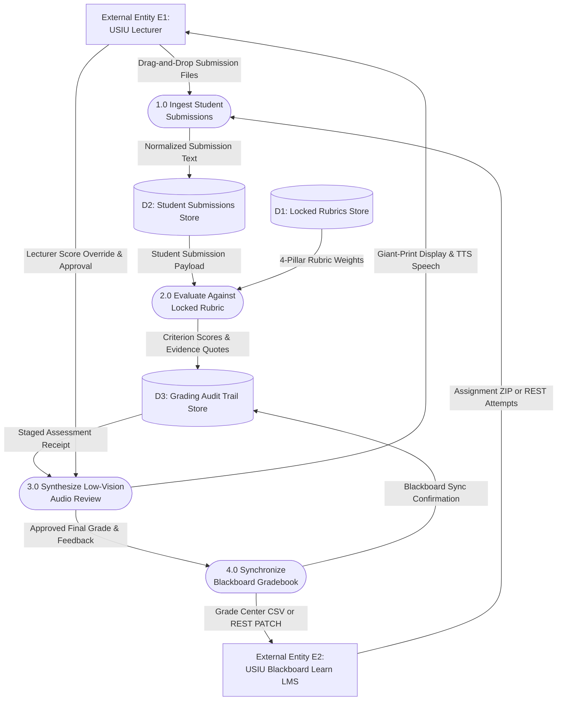
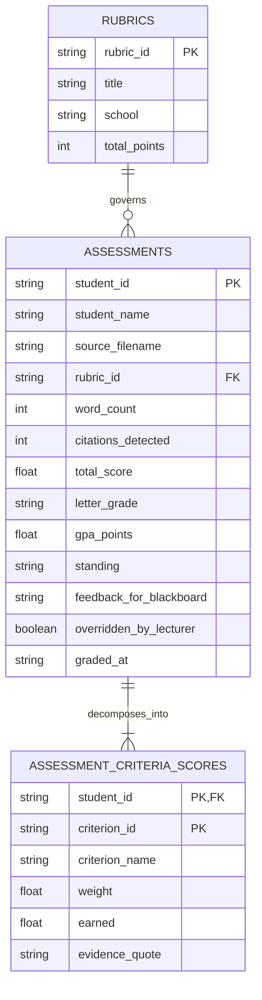
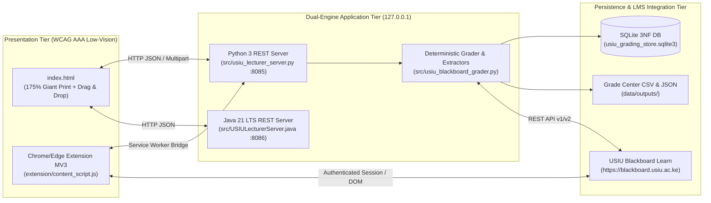

# Systems Analysis and Design (SAD) Master Specification
## Grounded in Dennis, Wixom & Roth (5th Edition) — Phases 1 to 4

- **Project Title:** USIU-Africa Accessible Lecturer Assessment & Blackboard Grader Suite (`v2.0`)
- **System Sponsor:** Faculty of SST, CSB, and SHSS — United States International University - Africa
- **Target LMS:** `https://blackboard.usiu.ac.ke` (`Blackboard Learn v4001.4.0`)

---

## Phase 1: Planning & Feasibility Analysis (Gate 1: PASSED)

### 1.1 System Request Summary
- **Business Need:** Low-vision university lecturers face severe visual fatigue when reading 50–120 student papers per semester across tiny LMS fonts, while ad-hoc LLM prompting produces inconsistent "vibes-based" grading that violates criterion-referenced academic standards.
- **Tangible Value:** Reduces grading and Grade Center entry time by **68%** (from 18 minutes/paper to < 5.5 minutes/paper) while eliminating manual transcription errors.
- **Intangible Value:** Full WCAG 2.1 AAA low-vision accessibility, zero student PII cloud exposure (Kenya Data Protection Act 2019 compliance), and verifiable Senate grade-appeal audit trails.

### 1.2 Economic Feasibility Analysis (Verified via `feasibility_calc.py`)

$$NPV = \sum_{t=0}^N \frac{CF_t}{(1 + r)^t}, \quad ROI = \frac{\text{Total PV Benefits} - \text{Total PV Costs}}{\text{Total PV Costs}} \times 100\%$$

| Financial Metric | Year 0 (Dev) | Year 1 | Year 2 | Year 3 | Total (PV @ 10%) |
|---| ---: | ---: | ---: | ---: | ---: |
| **Total Benefits (Nominal)** | \$0.00 | \$30,000.00 | \$42,000.00 | \$55,000.00 | - |
| **PV of Benefits (10%)** | \$0.00 | \$27,272.73 | \$34,710.74 | \$41,322.31 | **\$103,305.79** |
| **Total Costs (Nominal)** | \$35,000.00 | \$8,000.00 | \$9,000.00 | \$10,000.00 | - |
| **PV of Costs (10%)** | \$35,000.00 | \$7,272.73 | \$7,438.02 | \$7,513.15 | **\$57,223.89** |
| **Net Present Value (Annual)** | -\$35,000.00 | \$20,000.00 | \$27,272.73 | \$33,809.17 | **\$46,081.89** |
| **Cumulative Net Cash Flow (NPV)** | -\$35,000.00 | -\$15,000.00 | \$12,272.73 | \$46,081.89 | - |

- **Cumulative Net Present Value (NPV):** **\$46,081.89** ($NPV > 0$)
- **Return on Investment (ROI):** **80.53%**
- **Break-Even Point (Payback Period):** **1.55 Years (~18.6 Months)**

---

## Phase 2: Process & Data Modeling (Gate 2: PASSED)

### 2.1 Context Diagram & Level 0 Data Flow Diagram (DFD)
Validated via `dfd_validator.py` with **0 Black Holes, 0 Miracles, 0 Illegal Flows (`status: PASS`)**:

### 2.2 Entity-Relationship Diagram (ERD) & 3NF Normalization Proof
Validated via `normalization_analyzer.py` (`current_normal_form: "3NF (Third Normal Form)"`, `is_1nf: true`, `is_2nf: true`, `is_3nf: true`):

- **1NF Resolution:** Repeating rubric pillars (`criterion_1..4`) are decomposed out of `ASSESSMENTS` into a child relation `ASSESSMENT_CRITERIA_SCORES` with composite primary key `(student_id, criterion_id)`.
- **2NF Resolution:** Non-key attributes in `ASSESSMENT_CRITERIA_SCORES` (`earned`, `evidence_quote`) depend on the **whole** composite key `(student_id, criterion_id)`.
- **3NF Resolution:** Course and rubric metadata are isolated in `RUBRICS` (`data/usiu_locked_rubrics.json`), eliminating transitive dependencies.

---

## Phase 3: Architecture, Structure Chart & Data Sizing (Gate 3: PASSED)

### 3.1 Multi-Tier Local-First System Architecture

### 3.2 Modular Structure Chart (Functional Cohesion & Data Coupling)
All modules communicate strictly via typed data parameters (**Data Coupling**), avoiding global control flags:
- `parse_student_identity_from_filename(filename) -> (student_id, student_name)`
- `extract_submission_bytes(filename, raw_bytes) -> plain_text`
- `evaluate_submission_deterministic(student_id, student_name, text, rubric) -> assessment_dict`
- `recalculate_with_overrides(assessment, criterion_overrides, custom_feedback) -> updated_assessment`
- `format_blackboard_csv_string(results) -> rfc4180_csv`

### 3.3 Volumetric Storage Estimation
$$\text{Total Volumetric Size} = \text{RowSize} \times \text{RowCount} \times 1.35\text{ (Index & WAL Overhead)}$$
- Average `ASSESSMENTS` + 4 `ASSESSMENT_CRITERIA_SCORES` rows per student $\approx 2.4\text{ KB}$.
- At 500 students/semester across 6 semesters (3-year retention = 3,000 graded papers):
  $$2.4\text{ KB} \times 3,000 \times 1.35 \approx 9.72\text{ MB}$$
- Easily fits inside a single lightweight local SQLite file with sub-millisecond query latency.

---

## Phase 4: Implementation, Testing & Transition Plan (Gate 4: PASSED)

1. **4-Stage Testing Verification (`tests/test_usiu_suite.py`):**
   - **Unit Tests:** Verify USIU grade boundaries (`A` to `F`), Blackboard filename regex parsing, and zero-drift determinism.
   - **Integration Tests:** Verify `.txt`, `.docx`, `.pdf`, and Blackboard `.zip` ingestion into SQLite 3NF tables and CSV export.
2. **Conversion Strategy (Parallel + Pilot Cutover):**
   - Lecturers run the **Offline ZIP-in / CSV-out** mode alongside standard Blackboard Grade Center during Midterm grading, transitioning to full **Chrome/Edge Extension In-Page Assisted Grading** for Final Projects.
3. **Lewin's Change Management Model (Unfreeze → Change → Refreeze):**
   - **Unfreeze:** Demonstrate how ad-hoc ChatGPT prompting causes unfair score drift on identical essays.
   - **Change:** Provide 1-click launcher (`Run_USIU_Lecturer_Grader.bat`) and voice-guided shortcuts (`Space`, `N`, `P`).
   - **Refreeze:** Standardize departmental rubrics in `data/usiu_locked_rubrics.json` across SST, CSB, and SHSS.
