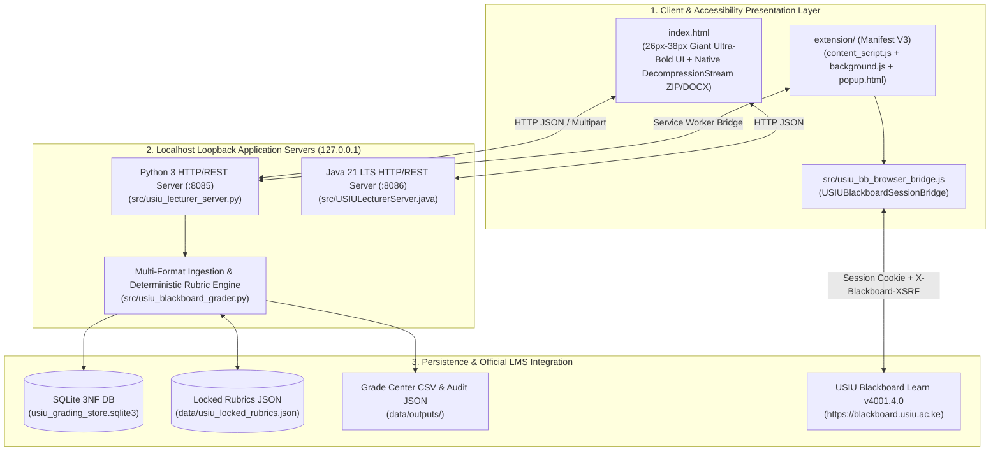

# 🛠️ TECHNICAL ARCHITECTURE, API & MAINTENANCE MANUAL
## USIU-Africa Accessible Lecturer Assessment & Blackboard Grader Suite (`v2.1`)

- **Target LMS:** `https://blackboard.usiu.ac.ke` (`Blackboard Learn v4001.4.0 • rel.58+b22e012`)
- **Primary Runtimes:** Python `3.10+` (`src/usiu_lecturer_server.py` on `:8085`), OpenJDK `21 LTS` (`src/USIULecturerServer.java` on `:8086`), and Chromium Manifest V3 (`extension/`)
- **Database Engine:** SQLite 3 (3NF Relational Schema with `ON DELETE CASCADE` in `data/outputs/usiu_grading_store.sqlite3`)
- **Zero-Leak Compliance:** 100% Loopback Execution (`127.0.0.1`), Zero External CDNs, Strict Origin Allowlisting, and Native Browser Session Authentication (`credentials: "include"`).

---

## 1. SYSTEM TOPOLOGY & RUNTIME MODES

The suite is engineered with **triple-redundant execution modes** so the lecturer is never blocked by workstation constraints or network policies:



---

## 2. MULTI-FORMAT DOCUMENT INGESTION ENGINE ([`src/usiu_blackboard_grader.py`](../src/usiu_blackboard_grader.py))

| File Format | Extraction Pipeline | Implementation Function |
| :--- | :--- | :--- |
| **`.txt` / `.md` / `.csv`** | Direct UTF-8 decoding with replacement fallback (`errors="ignore"`). | [`extract_submission_bytes()`](../src/usiu_blackboard_grader.py#L288-L297) |
| **`.docx` (Word OpenXML)** | Opens in-memory `zipfile.ZipFile(io.BytesIO(raw_bytes))`, parses `word/document.xml` via `xml.etree.ElementTree`, and extracts all `<w:p>` paragraph runs (`<w:t>`). In standalone browser mode, uses [`unpackNativeZipEntries()`](../index.html#L793-L827) backed by the browser's native `DecompressionStream("deflate-raw")`. | [`extract_text_from_docx_bytes()`](../src/usiu_blackboard_grader.py#L222-L238) |
| **`.pdf` (Adobe PDF 1.4+)** | **Two-stage zero-dependency parser:**<br/>1. Uses `pypdf` / `PyPDF2` if installed.<br/>2. Falls back to a pure-Python `zlib` `FlateDecode` stream decompressor (`MAX_WBITS` and `-MAX_WBITS`) + PDF literal text operator (`(...) Tj` / `TJ`) regex parser. | [`extract_text_from_pdf_bytes()`](../src/usiu_blackboard_grader.py#L241-L285) |
| **`.zip` (Blackboard Bulk Archive)** | Iterates through all non-hidden entries (`.txt`, `.md`, `.docx`, `.pdf`), parses Blackboard's `Assignment_StudentID_attempt_YYYY-MM-DD-HH-MM-SS_Filename` pattern via [`parse_student_identity_from_filename()`](../src/usiu_blackboard_grader.py#L165-L202), and grades each student attempt. | [`ingest_zip_bytes()`](../src/usiu_blackboard_grader.py#L304-L330) |

---

## 3. DETERMINISTIC RUBRIC SCORING MATHEMATICAL SPECIFICATION

To guarantee **0.0% prompt drift** across a cohort, [`evaluate_submission_deterministic()`](../src/usiu_blackboard_grader.py#L333-L421) computes each criterion score $S_i$ (for $i \in \{1..4\}$ with weight $W_i$ where $\sum W_i = 100$) using:

1. **Keyword & Concept Coverage Ratio ($K_i \in [0, 1]$):**
   $$K_i = \min\left(1.0,\; \frac{|\{k \in \text{Keywords}_i : k \in \text{SubmissionText}\}|}{\max(1.0,\; 0.45 \times |\text{Keywords}_i|)}\right)$$
2. **Submission Depth Factor ($L \in [0, 1]$):**
   $$L = \min\left(1.0,\; \frac{\text{WordCount}}{\max(50.0,\; \text{MinWords}_{\text{rubric}})}\right)$$
3. **Empirical APA 7th Citation Bonus ($C_i \in [0, 0.15]$):**
   Matches in-text citations via `\([A-Za-z\s,&.\-]+,?\s*(?:19|20)\d{2}[a-z]?\)`:
   $$C_i = \begin{cases} \min\left(0.15,\; 0.15 \times \frac{\text{CitationsDetected}}{\text{ExpectedCitations}_{\text{rubric}}}\right) & \text{if criterion } i \text{ evaluates citations/evidence} \\ 0.0 & \text{otherwise} \end{cases}$$
4. **Criterion Score ($S_i$) & Short-Submission Penalty:**
   $$R_i = \min\left(1.0,\; 0.45 + 0.45 K_i + 0.10 L + C_i\right) \times \begin{cases} 0.55 & \text{if } \text{WordCount} < 40 \\ 1.0 & \text{otherwise} \end{cases}$$
   $$S_i = \text{round}(W_i \times R_i,\; 1), \quad S_{\text{total}} = \min\left(100.0,\; \sum_{i=1}^4 S_i\right)$$

---

## 4. LOCAL HTTP/REST API REFERENCE ([`src/usiu_lecturer_server.py`](../src/usiu_lecturer_server.py))

Default bind address: `http://127.0.0.1:8085`

| Method & Path | Request Payload / Query | Response Payload | Description |
| :--- | :--- | :--- | :--- |
| `GET /` | None | `text/html` | Serves the Giant-Print Low-Vision Grading Hub ([`index.html`](../index.html)). |
| `GET /api/health` | None | `{"status": "ONLINE", "rubrics_available": [...], "submissions_count": 6}` | Health check & active cohort count. |
| `GET /api/rubrics` | None | `{"rubrics": {...}, "grading_scale": [...]}` | Returns all locked & custom USIU rubrics plus the USIU `A`–`F` GPA scale. |
| `GET /api/submissions` | None | `{"submissions": [...]}` | Lists all graded student submissions and 4-pillar breakdowns from SQLite. |
| `POST /api/ingest` | `multipart/form-data` (`files`, `rubric_id`) OR JSON `{"rubric_id": "...", "files": [{"filename": "...", "content_base64": "...", "text": "..."}]}` | `{"status": "INGESTED", "ingested_count": N, "submissions": [...]}` | Extracts text from `.pdf`/`.docx`/`.txt`/`.zip`, evaluates against the selected rubric, upserts into SQLite, and regenerates CSV/JSON exports. |
| `POST /api/override` | `{"student_id": "665421", "criterion_overrides": {"thesis_clarity": 28.0}, "feedback_for_blackboard": "..."}` | `{"status": "UPDATED", "assessment": {...}, "submissions": [...]}` | Applies lecturer slider/`+/- 1 PT` overrides, recalculates USIU letter grade & GPA, and updates SQLite + CSV. |
| `POST /api/rubrics/save` | `{"title": "...", "course_code": "APT3040", "min_words": 220, "expected_citations": 3, "criteria": [...], "regrade_existing": true}` | `{"status": "RUBRIC_SAVED", "rubric": {...}, "submissions": [...]}` | Normalizes pillar weights to `100.0`, saves to [`data/usiu_locked_rubrics.json`](../data/usiu_locked_rubrics.json), and optionally re-marks the cohort. |
| `POST /api/speak` | `{"text": "Assessment for Amina Wanjiku..."}` | `{"status": "SPOKEN"}` | Invokes offline Windows SAPI5 `System.Speech.Synthesis.SpeechSynthesizer`. |
| `GET /api/export/csv` | None | `text/csv` attachment | Downloads `USIU_Blackboard_GradeCenter_Upload.csv`. |
| `GET /api/export/json` | None | `application/json` | Downloads `USIU_Grading_Audit_Report.json`. |
| `POST /api/blackboard/sync` | `{"course_id": "_10482_1", "column_id": "_58291_1", "access_token": ""}` | `{"status": "SYNC_COMPLETE", "count": N, "results": [...]}` | Stages or executes REST `PATCH` payloads for Blackboard Learn Grade Center. |

---

## 5. SQLITE 3NF DATABASE SCHEMA ([`USIUGradingDatabase`](../src/usiu_lecturer_server.py#L58-L214))

File location: `data/outputs/usiu_grading_store.sqlite3`

```sql
CREATE TABLE IF NOT EXISTS assessments (
    student_id TEXT PRIMARY KEY,
    student_name TEXT NOT NULL,
    source_filename TEXT,
    rubric_id TEXT NOT NULL,
    rubric_title TEXT,
    word_count INTEGER DEFAULT 0,
    citations_detected INTEGER DEFAULT 0,
    total_score REAL NOT NULL,
    letter_grade TEXT NOT NULL,
    gpa_points REAL NOT NULL,
    standing TEXT,
    feedback_for_blackboard TEXT,
    overridden_by_lecturer INTEGER DEFAULT 0,
    blackboard_sync_json TEXT,
    graded_at TEXT NOT NULL
);

CREATE TABLE IF NOT EXISTS assessment_criteria_scores (
    student_id TEXT NOT NULL,
    criterion_id TEXT NOT NULL,
    criterion_name TEXT NOT NULL,
    weight REAL NOT NULL,
    earned REAL NOT NULL,
    evidence_quote TEXT,
    PRIMARY KEY (student_id, criterion_id),
    FOREIGN KEY (student_id) REFERENCES assessments(student_id) ON DELETE CASCADE
);
```

---

## 6. BLACKBOARD LEARN `v4001.4.0` SESSION BRIDGE & SECURITY ARCHITECTURE

Implemented in [`src/usiu_bb_browser_bridge.js`](../src/usiu_bb_browser_bridge.js) and [`extension/content_script.js`](../extension/content_script.js):

1. **Zero Credential Touch:**
   - The extension never prompts for or reads USIU login credentials. It relies strictly on the browser's `HttpOnly` session cookie (`credentials: "include"`) established when the lecturer logs into `https://blackboard.usiu.ac.ke`.
2. **Automatic CSRF/XSRF Header Discovery (`getBlackboardXsrfToken()`):**
   - Inspects `<meta name="X-Blackboard-XSRF">`, `<input name="blackboard.platform.security.NonceUtil.nonce">`, and `XSRF-TOKEN` cookies, attaching `X-Blackboard-XSRF` to all REST calls.
3. **Origin Allowlist & Loopback Binding:**
   - Both Python (`127.0.0.1:8085`) and Java (`127.0.0.1:8086`) servers bind strictly to loopback `127.0.0.1` and restrict `Access-Control-Allow-Origin` to `https://blackboard.usiu.ac.ke`, `http://127.0.0.1:8085`, and `chrome-extension://*`.

---

## 7. BUILD, TEST & DEPLOYMENT COMMANDS

### 7.1 Run the Automated Verification Suite (`7/7` Unit & Integration Tests)
```bash
python tests/test_usiu_suite.py
```

### 7.2 Run the Python 3 Local Server
```bash
python src/usiu_lecturer_server.py --host 127.0.0.1 --port 8085
```

### 7.3 Compile & Run the Enterprise Java 21 Server
```bash
javac src/USIULecturerServer.java
# CLI Batch Test Mode:
java -cp src USIULecturerServer --cli-test
# HTTP Server Mode on port 8086:
java -cp src USIULecturerServer --port 8086
```

### 7.4 Package the Chrome/Edge Manifest V3 Extension
Zip the contents of [`extension/`](../extension/) into `data/outputs/USIU_Blackboard_Accessible_Extension_v2.0.zip` or load [`extension/`](../extension/) unpacked via `chrome://extensions` / `edge://extensions`.
